

  <picture>
    <source media="(prefers-color-scheme: dark)" srcset="docs/logo-dark.png">
    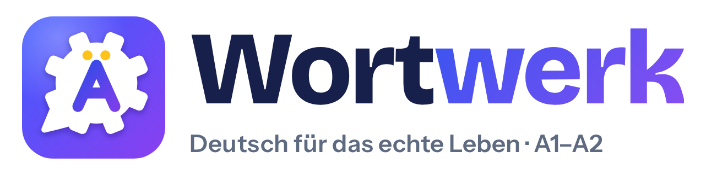
  </picture>

# Wortwerk 🇩🇪 — learn German for real life

**A free German learning app for your phone — A1 to A2, following the chapters of the textbook *Netzwerk neu*.**
Words, grammar, reading, real-life missions and exam training in one place. No account, no ads, works offline.

### 👉 [Open Wortwerk](https://oguzhanbzglu.github.io/wortwerk/)

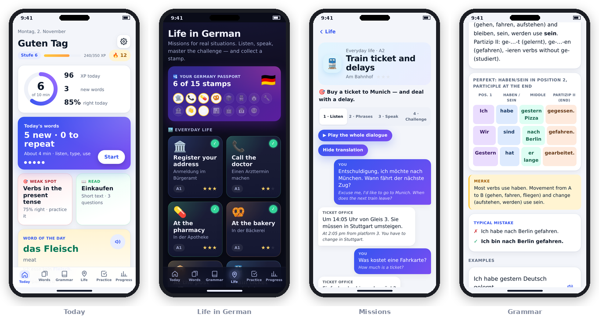

---

## Contents

1. [What's inside](#whats-inside)
2. [Get started in 3 minutes](#get-started-in-3-minutes)
3. [Today — your daily routine](#today--your-daily-routine)
4. [Words](#words)
5. [Grammar](#grammar)
6. [Reading](#reading)
7. [Life in German — missions](#life-in-german--missions)
8. [Practice — tests, mini exams and speaking](#practice--tests-mini-exams-and-speaking)
9. [Progress, badges and settings](#progress-badges-and-settings)
10. [Dark mode](#dark-mode)
11. [Tips](#tips)
12. [Your data and privacy](#your-data-and-privacy)
13. [Questions and problems](#questions-and-problems)
14. [Host your own copy](#host-your-own-copy)
15. [About](#about)

---

## What's inside

| | |
|---|---|
| 📚 **1,145 words** | In 24 chapters (A1 and A2), each with article, plural, example sentence, translation and audio |
| 🧠 **Smart repetition** | Words come back right before you would forget them |
| 📐 **60 grammar topics** | Plain explanations, colourful diagrams, typical mistakes and endless practice |
| 📖 **48 reading texts** | Tap any word to see its meaning; a translation for every sentence |
| 🗺️ **15 real-life missions** | Doctor, Bürgeramt, bakery, train, landlord, bank, first day at work, meetings… |
| 🎓 **Exam training** | Mini exams in the style of Goethe A1 and A2 / DTZ |
| 🗣️ **Speaking practice** | Role-plays and exam speaking tasks, with the microphone or by typing |
| 🏆 **Motivation** | XP and levels, streaks, combos, 21 badges and a passport with stamps |
| 📴 **Works offline** | After the first open, no internet needed |
| 🔒 **Private** | Your progress stays on your phone, protected by a password |

---

## Get started in 3 minutes

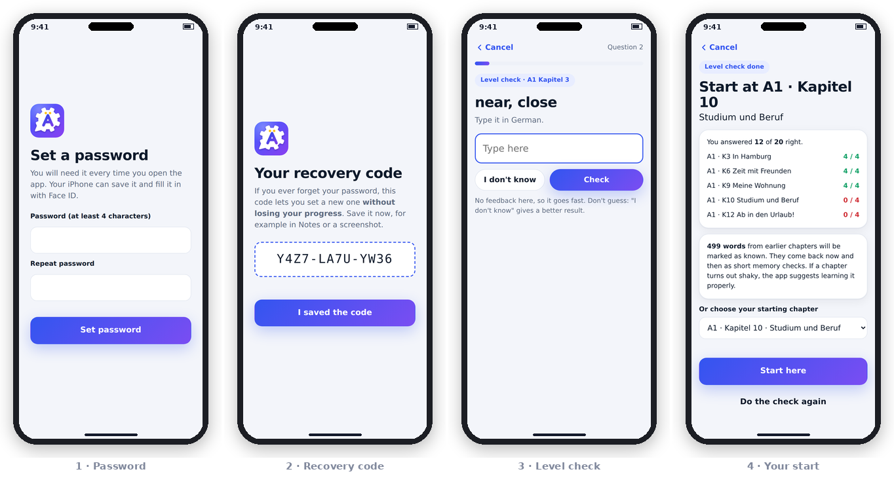

**1. Open the app**
Go to **https://oguzhanbzglu.github.io/wortwerk/** on your phone.

**2. Put it on your home screen** (so it opens like a normal app)
- **iPhone:** open the link in **Safari** → tap **Share** (the square with the arrow) → **Add to Home Screen** → **Add**.
- **Android:** open the link in **Chrome** → tap **⋮** → **Install app** (or **Add to Home screen**).

**3. Set a password**
The app asks for a password the first time. Then it shows a **recovery code** like `FWA6-RFP4-QYK3`.
**Save this code** (screenshot or Notes). If you ever forget your password, the code lets you set a new one **without losing your progress**.

**4. Find your level** (about 3 minutes, optional)
The **level check** asks a few words and grammar questions from different chapters and then suggests where you should start.
Words from earlier chapters are marked as known — they come back now and then as short memory checks, so nothing gets lost.
Beginners can skip this and start at chapter 1.

---

## Today — your daily routine

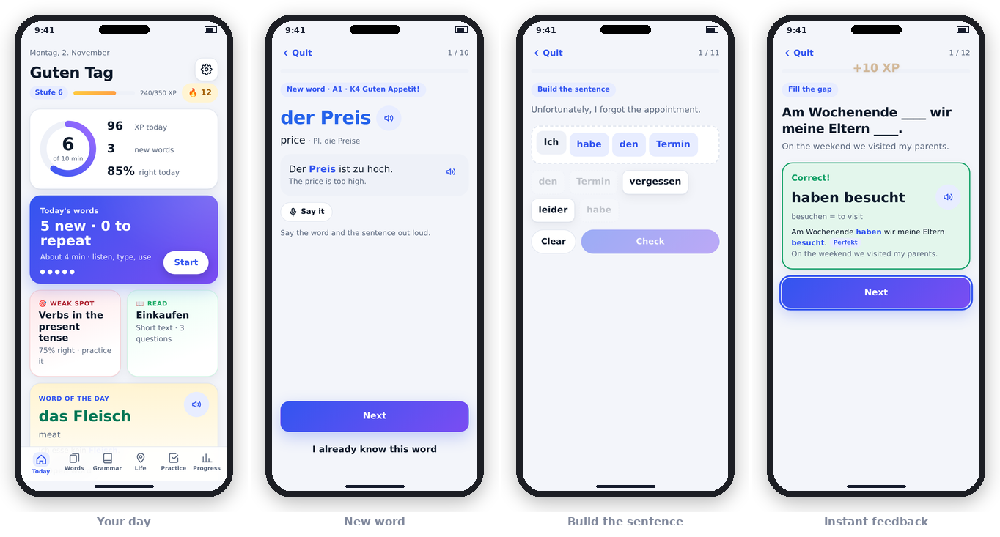

The **Today** tab shows everything for the day:

- **The ring** — your learning minutes today (goal: 10 minutes, you can change it).
- **Today's words** — tap **Start** for your daily session: about **5 new words** plus the words that are due for review.
- **Quick test, Read, Weak spot** — short extras for when you have more time.
- **Word of the day** — one word from your current chapter to listen to.

**What happens in a session**

| Exercise | What you do |
|---|---|
| **New word** | See and hear the word with an example sentence. Say it out loud. |
| **Say it in German** | Type the German word (with *der/die/das* for nouns). |
| **Fill the gap** | Complete the example sentence. |
| **Listen** | Hear a word and choose its meaning. |
| **Dictation** | Hear a word and type it. |
| **Build the sentence** | Tap the words in the right order. Other correct word orders are accepted too. |
| **Phrase** | Complete a useful set phrase like *einen Termin vereinbaren*. |

Good to know:
- **Hint** shows the first letters (it costs a little less than a wrong answer).
- **"I already know this word"** skips a word you know and brings the next one.
- Small mistakes like a missing umlaut (*schon* for *schön*) or *ss* for *ß* count as **"almost"**.
- After a wrong answer you type it once correctly — that locks it in.
- Typing the full sentence, or another word with the same meaning, is accepted too.

**How the memory system works**
Every right answer makes the gap to the next review longer (1 → 2 → 5 → 12 → 30 days …). A wrong answer brings the word back soon. After about 12 days a word counts as **known**, and it is checked again after 3 weeks, 2 months and 4 months. On days with many reviews the app gives you fewer new words, so you never fall behind.

---

## Words

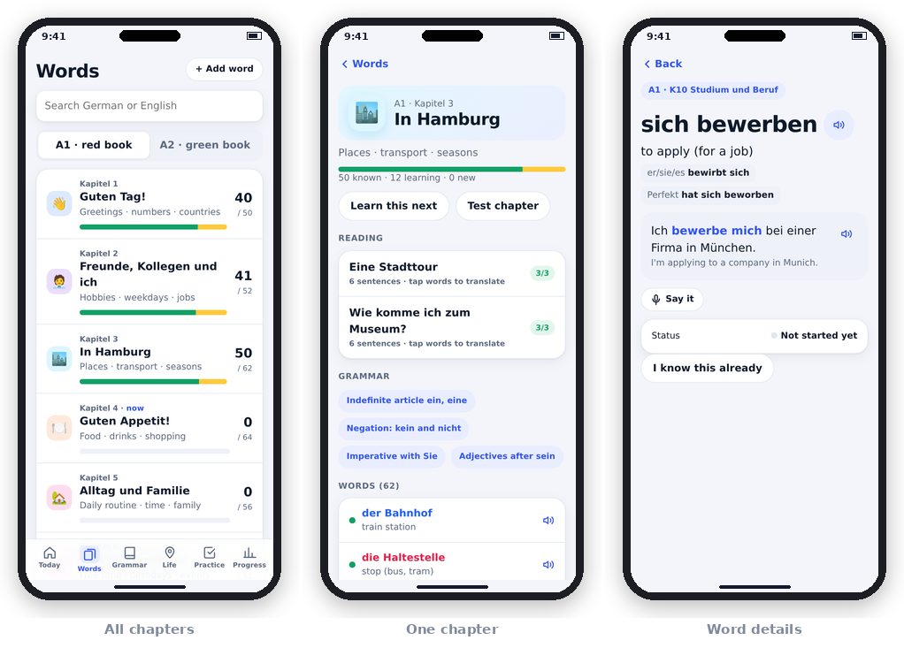

- **24 chapters** in the order of *Netzwerk neu* (A1 = red book, A2 = green book), each with its own colour and icon.
- **der / die / das** are always coloured: **blue = der**, **red = die**, **green = das**.
- Tap a word to see the **plural**, an **example sentence** with translation, a **useful phrase**, and the **book forms**:
  verbs like *fahren · er fährt · ist gefahren*, adjectives like *groß → größer → am größten*.
- **Article tips**: endings like *-ung, -heit, -keit* (→ *die*) or *-chen* (→ *das*) are pointed out.
- **+ Add word** — add your own words; they come into your daily sessions first.
- The search box finds words in German and in English.

---

## Grammar

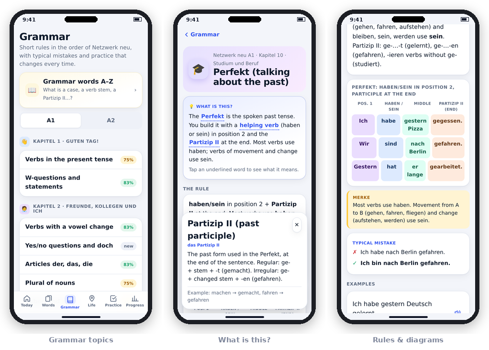

Each of the **60 topics** follows the book and is built the same way:

1. **💡 What is this?** — a plain explanation. Underlined words like *accusative* or *Partizip II* can be tapped for a simple definition.
2. **The rule** — short and clear.
3. **Diagram** — sentence-position boxes, colour-coded case tables, pictures of prepositions (*auf, unter, neben…*), time lines and more.
4. **Merke** — a tip to remember, like in the book.
5. **Typical mistake** — wrong ✗ and right ✓.
6. **Examples** with audio, and **Practice** — 8 new questions every time.

At the top of the Grammar tab, **Grammar words A–Z** explains 50 grammar terms in simple English.

---

## Reading

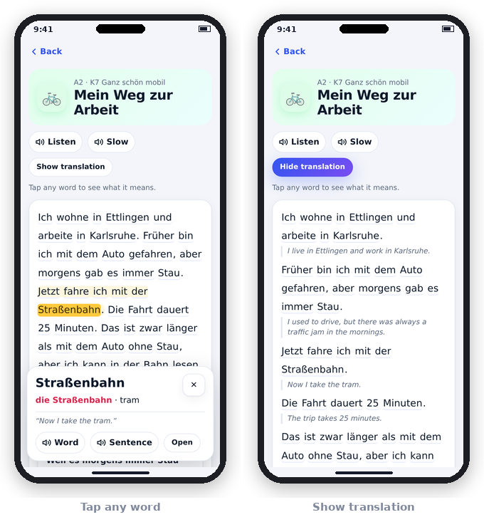

- **48 short texts** (2 per chapter), from *Hallo, ich bin Lena* to describing a painting.
- **Tap any word** to see its meaning. The app recognises forms like *fährt*, *gefahren* or *Kartoffeln*, and even parts of compound words (*Apfelkuchen* → *Kuchen*).
- **＋ Learn this word** adds it to your next session.
- **Show translation** shows the English under every sentence.
- **Listen** or **Slow** reads the whole text aloud. Each text ends with 3 questions.

---

## Life in German — missions

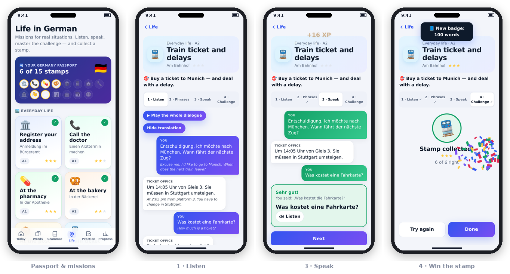

**15 missions** for situations people really meet in Germany:

- **Everyday life:** register your address · call the doctor · pharmacy · bakery · post office · train ticket and delays · viewing a flat · something broken in your flat · opening a bank account
- **At work:** meet your new team · small talk at the coffee machine · a meeting · a machine problem · moving a meeting · calling in sick

Every mission has four steps:

1. **Listen** — the dialogue as chat bubbles. Play it all, or tap a line. Translation on/off.
2. **Phrases** — the key sentences, the questions people will ask you (with good answers), and **ready-made emails** to copy (to a landlord, to your boss…).
3. **Speak** — a role-play: the app plays the other person, you say or type your lines. You get the meaning and a first-letter hint. Green = spot on.
4. **Challenge** — 6 quick questions. **4 right = a stamp in your Germany passport**, all 6 = ⭐⭐⭐.

---

## Practice — tests, mini exams and speaking

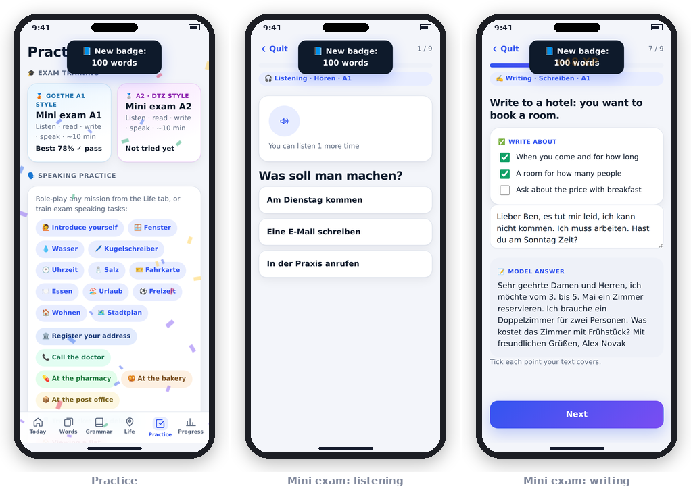

**🎓 Mini exams** (about 10 minutes) in the format of **Goethe A1** and **A2 / DTZ**:
- **Listening** — announcements and phone messages (you can play each one twice, like in the real exam)
- **Reading** — signs, notes and letters
- **Writing** — a short message; then compare with a model answer and tick the points you covered
- **Speaking** — introduce yourself, make requests, talk about a topic

You see a score for each skill and **"Bestanden!"** at 60% or more.

**🗣️ Speaking practice** — 12 exam speaking tasks, plus a role-play of any mission.

**🧪 Tests** — quick test (10 questions), mixed test (20), weak spots, vocabulary, one chapter, one grammar topic or one type of mistake. Questions are never the same twice, and after each test you see what to practise.

---

## Progress, badges and settings

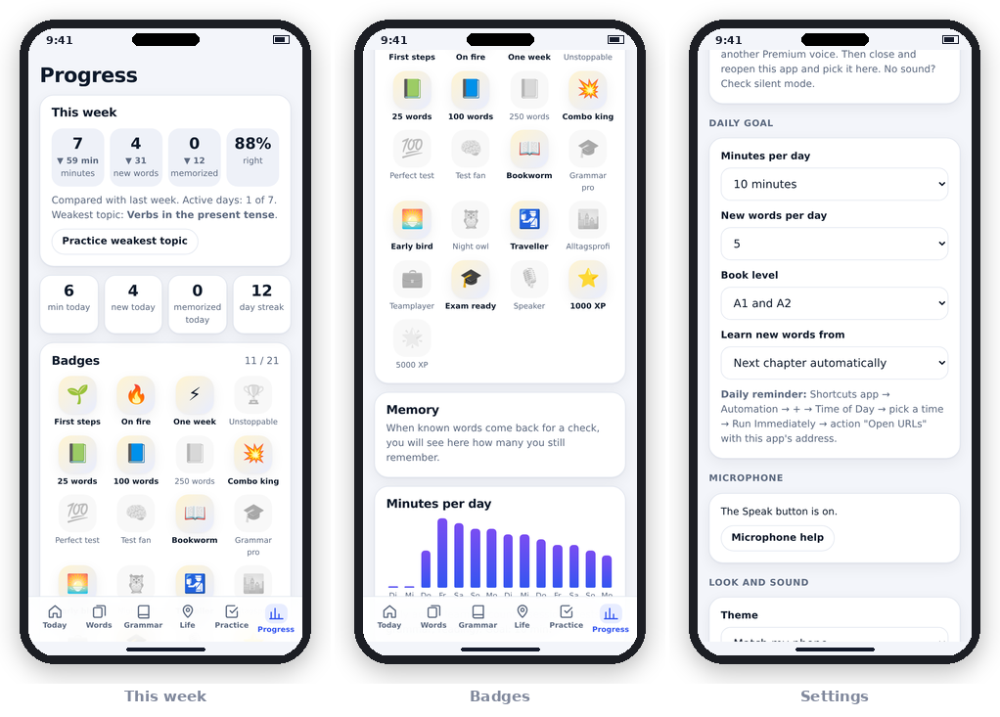

- **This week vs. last week** — minutes, new words, memorized words, % right.
- **Charts** of your minutes and words per day, your **day streak** and best streak.
- **Mistake types** — see if your mistakes come from articles, cases, word order, verb forms, spelling or listening, and practise exactly that.
- **21 badges** — First steps 🌱, On fire 🔥, Combo king 💥, Bookworm 📖, Traveller 🛂, Exam ready 🎓 …

**Settings** (gear icon on Today):
- Daily goal (5–30 minutes) and new words per day (3–15)
- Level (A1, A2 or both) and focus chapter
- German voice and speed, microphone help
- Theme (light / dark / like your phone) and sound effects (marimba, chime or off)
- Password, auto-lock and backup

---

## Dark mode

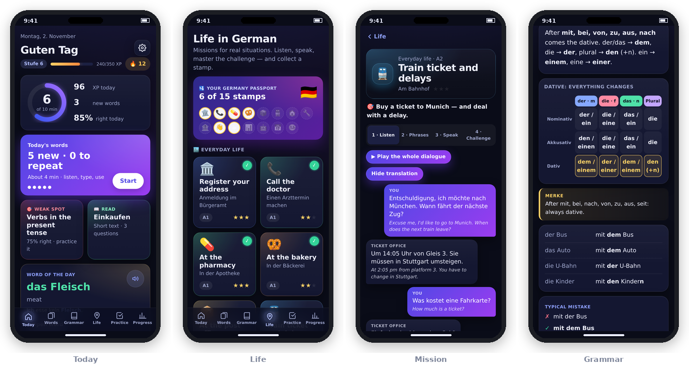

The app follows your phone's light or dark mode automatically. You can also choose it in **Settings → Look and sound**.

---

## Tips

**🔊 Get a better German voice (iPhone)**
iPhone **Settings → Accessibility → Spoken Content → Voices → German** → download **Anna (Premium)** or another *Premium* / *Enhanced* voice. Close and reopen Wortwerk, then pick the voice in **Settings → Voice**.
On Android the Google German voice is used.

**🎤 Speaking with the microphone**
- On **Android (Chrome)** the **Speak** button usually works right away.
- On **iPhone**, Apple sometimes blocks speech recognition for web apps. If that happens, the app shows help and switches to the easiest way: **tap the answer box and use the 🎤 key on your keyboard** (iPhone dictation). It works everywhere in the app.

**⏰ A daily reminder**
- **iPhone:** Shortcuts app → **Automation** → **Time of Day** → action **Open URLs** → paste the app link.
- Or tie it to a habit — for example, open Wortwerk every time you would open social media.

**💪 Get the most out of it**
- 10 minutes every day beats one hour on Sunday.
- Say every word and sentence **out loud**.
- Do the **mission** for a situation before it happens in real life.

---

## Your data and privacy

- Everything you learn is saved **only on your phone** (in the browser storage of this app). There is no account and no server.
- The password protects the app on your phone.
- **Make a backup now and then:** **Settings → Backup → Save backup file**. On a new phone: **Load backup file**. The app reminds you after 14 days.
- Deleting the app or clearing Safari/Chrome website data **deletes your progress** — so keep a backup.

---

## Questions and problems

**The app didn't update / I don't see the new features.**
Close the app completely and open it twice (with internet). New versions load in the background.

**"Allow the microphone…" / the Speak button doesn't work.**
Use the 🎤 key on your keyboard (see [Tips](#tips)). To try the Speak button again: **Settings → Microphone → Microphone help**.

**No sound.**
Check the silent switch and the volume, then **Settings → Voice → Test voice**.

**I forgot my password.**
On the lock screen tap **Forgot password?** and enter your **recovery code** — your progress stays. Without the code you can only start over.

**I got a new phone.**
Old phone: **Settings → Backup → Save backup file** and send it to yourself. New phone: open the app → **Settings → Backup → Load backup file**.

**I found a mistake in a word or sentence.**
Please tell us (see [About](#about)) — every report makes the app better.

---

## Host your own copy

Wortwerk is a single web page — no build step, no server, no framework.

| File | What it is |
|---|---|
| `index.html` | The whole app (code, words, texts, styles) |
| `sw.js` | Service worker — makes the app work offline |
| `manifest.webmanifest` | App name and icon for "Add to Home Screen" |
| `icon-180.png`, `icon-512.png` | App icons |
| `docs/` | Images for this README |

**Put it online with GitHub Pages (free):**
1. Create a GitHub account and a new **public** repository.
2. Upload all the files above.
3. **Settings → Pages → Branch: `main`, folder: `/ (root)` → Save**.
4. After 1–2 minutes the app is at `https://YOUR-NAME.github.io/REPOSITORY/`.

**Updating:** upload the new `index.html` and `sw.js` (the cache name in `sw.js` changes with each version, e.g. `wortwerk-v14`). Users get the update the next time they open the app.

---

## About

- Wortwerk follows the **chapter topics** of the textbook series **Netzwerk neu A1 / A2 (Klett)**, so it fits next to a German course.
  It is an independent project and **not affiliated with Klett**. All words, sentences, texts and explanations were written for this app; the word list is a selection per chapter, not the official Klett word list.
- The content is written carefully but has not yet been checked by a German teacher. If you find a mistake, please open an **Issue** in this repository.
- **The logo:** a gear (*Werk* — works, workshop) that is also a speech bubble (*Wort* — word), with an **Ä** inside. Learning German, built like an engineer would.
- Made with ❤️ to replace doomscrolling with something useful. *Viel Erfolg beim Deutschlernen!*
